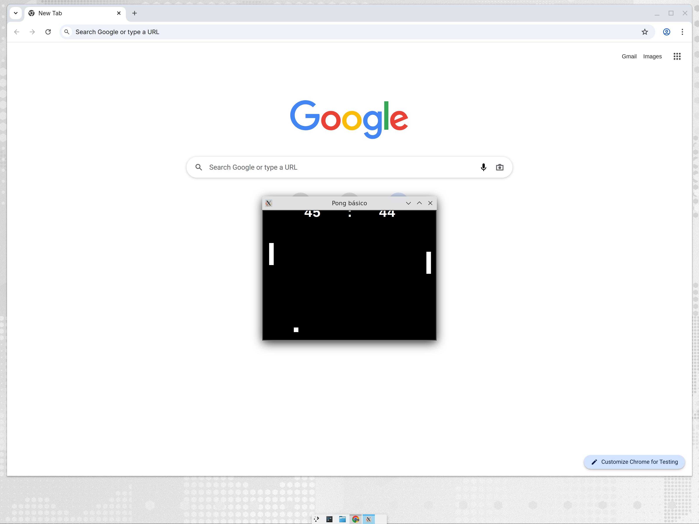

# Pong con `turtle` — cuaderno y juego

Versión extremadamente básica del **Pong** con la librería estándar `turtle`
de Python, pensada para clase.

- **`pong-turtle.ipynb`** — cuaderno explicativo paso a paso (ventana, palas,
  pelota y velocidad, controles, bucle principal y colisiones) con el código
  completo al final y retos de ampliación. Ábrelo directamente en Colab:

  

- **`pong.py`** — el juego completo (~100 líneas comentadas en castellano).

> `turtle` abre una ventana real: el juego se ejecuta en tu equipo
> (IDLE, Thonny, VS Code o terminal: `python3 pong.py`), no dentro de Colab.
> El cuaderno es la guía de lectura; el juego se copia y se ejecuta en local.

## Controles

- Jugador izquierdo: **W** (subir) / **S** (bajar)
- Jugador derecho: **↑** / **↓**

